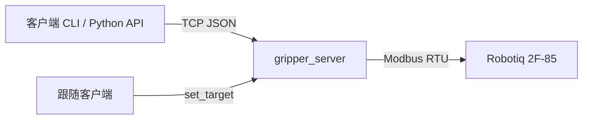

# 架构与协议

xcore-gripper-2F85 通过 USB/RS485 控制 Robotiq 2F-85，并提供一个小的 TCP
JSON 服务，让控制电脑或其他主机发送夹爪命令。

## 组成

| 模块 | 职责 |
| --- | --- |
| `robtiq_gripper_mdbsrtu.py` | 串口、Modbus RTU 寄存器读写 |
| `gripper_sdk.py` | 位置/闭合度换算和激活、运动封装 |
| `gripper_server.py` | TCP 请求处理、连续目标流和看门狗 |
| `gripper_client.py` | 客户端连接与错误封装 |
| `cli.py` | 人类可读命令和实时观察 |

## 位置约定

- `pos`：原始值，0 = 全开，255 = 全闭。
- `closure`：归一化，0.0 = 全开，1.0 = 全闭，与 GELLO 扳机一致。
- `openness`：1.0 = 全开，仅用于显示。

## 连续跟随

`set_target` 持续刷新目标；服务端在目标流中断超过 `stale_timeout_s` 后报
`Gripper target stream timed out`。这是保护状态，不是需要反复重启的故障。
退出时应显式发送 `stop`，或用顶层 `--reset-stream` 清理空闲锁定。

## 安全边界

- 服务默认监听 `0.0.0.0:5005`，仅在可信网络使用。
- 夹爪串口不能与 GELLO 主臂串口混用。
- 服务重启会激活夹爪；跟随或退出返回运行期间不要重启。
